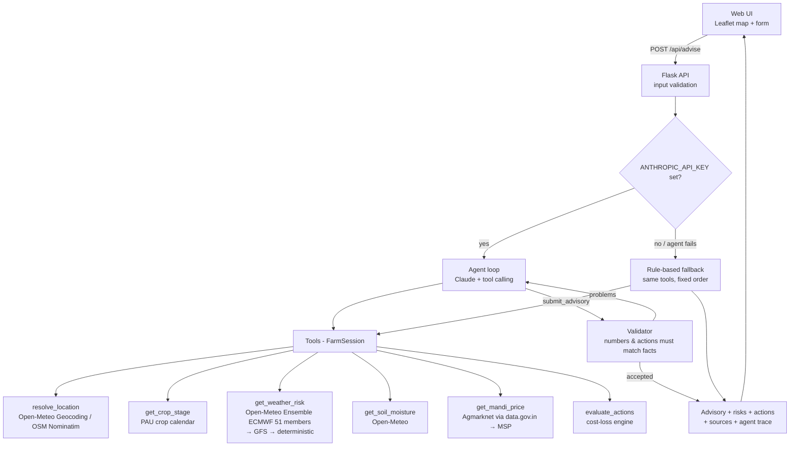

# 🌾 FasalKavach: Micro-location crop weather-risk advisor for Punjab

> Forecasts tell farmers what the weather *might* do. FasalKavach tells them **what to do about it, and whether it's worth the cost.**

**Track:** Climate, Resource Infrastructure & Global Supply Resilience. Problem 2: Predictive Climate & Micro-Location Yield Engine.

## The problem

Unseasonal rain, hail-storms, wind and heat spells hit Punjab wheat and rice at the worst moments (flowering, grain filling, harvest). Farmers get generic district forecasts ("chance of rain") but no answer to the real question: *should I spray today, irrigate, or harvest early, and is it worth the money?* Acting on every alert wastes money; ignoring them risks the crop.

**Target users:** smallholder wheat and rice farmers in Punjab, plus Krishi Vigyan Kendra / agri-extension officers who advise them.

## What it does

1. The farmer marks their field on a map (or types a village), picks wheat or rice, and enters the sowing or transplanting date and area.
2. An **AI agent** gathers live data: a 51-member ensemble weather forecast, soil moisture, and today's mandi price.
3. A deterministic engine computes **P(event)** for heavy rain, strong wind, heat stress and frost from the ensemble, and weights it by **how sensitive the current crop stage is**.
4. A **cost-loss decision engine** checks each protective action: *P(event) × loss avoided > cost of action?*
5. The agent explains the result in **English, Hindi or Punjabi**. A **validator** rejects any number or recommendation that doesn't come from the computed data, and the agent then fixes its answer.

## Architecture



### Folder structure

```
fasalkavach/
├── app.py              Flask routes + input validation
├── config.py           settings & env vars
├── engine/             pure logic, no network: easy to test and explain
│   ├── crops.py        knowledge base: stages, sensitivities, actions, costs (with sources)
│   ├── stage.py        sowing date → growth stage
│   ├── risk.py         ensemble forecast → event probabilities
│   └── decision.py     cost-loss decision engine
├── data/               live API clients
│   ├── http.py         retries + 30-min cache + stale-cache fallback
│   ├── weather.py      Open-Meteo ensemble / forecast / soil moisture
│   ├── location.py     geocoding, Punjab check
│   └── mandi.py        Agmarknet prices → MSP fallback
├── agent/
│   ├── tools.py        tools the agent can call + their JSON schemas
│   ├── loop.py         the agent loop (plan → call tools → validate → retry)
│   ├── validator.py    hallucination guardrail
│   └── fallback.py     rule-based path when the LLM is unavailable
├── templates/ static/  frontend
└── tests/              pytest suite (offline, stubs for HTTP)
```

## Key ideas (for judges and for us)

**Ensemble probability.** An ensemble forecast runs the same weather model many times with slightly different starting conditions. If 33 of 51 runs show ≥20 mm of rain, P = 65%. The probability over a *window* counts the members where the event happens on *any* day in that window, rather than adding up daily probabilities.

**Crop-stage sensitivity.** 20 mm of rain barely matters during tillering but can destroy 15% of a mature wheat crop. Each stage has a damage fraction per event (`engine/crops.py`).

**Cost-loss decision.**
```
expected loss avoided = P(event) × damage fraction × crop value (yield × live mandi price) × action effectiveness
recommend the action  if  expected loss avoided > action cost
```
So the same 40% rain chance can mean "harvest now" for a ripe crop and "do nothing" for a young one.

**Guardrails.** The LLM never does arithmetic. `validator.py` extracts every number from the advisory (including Hindi and Punjabi digits) and checks it against the tool outputs. The recommended actions must exactly match what the engine approved. If either check fails, the agent gets the list of problems and has to fix them.

**Robustness.** Each data source has a fallback chain: ECMWF → GFS → single-run forecast for weather, district price → Punjab price → MSP for mandi prices. Responses are cached and a stale cache is served if an API goes down. Bad input gets a clear error. If the LLM fails, the rule-based path produces the same numbers.

## Setup

```bash
cd fasalkavach
python -m venv venv
source venv/bin/activate          # Windows: venv\Scripts\activate
pip install -r requirements.txt
cp .env.example .env              # then fill in the keys
python app.py                     # open http://localhost:5000
```

Keys:
- `ANTHROPIC_API_KEY`: from console.anthropic.com. Without it the app runs in rule-based mode.
- `DATA_GOV_API_KEY`: free, from data.gov.in (sign up, then "My Account" → API key). Without it, prices fall back to MSP.

Run the tests:
```bash
python -m pytest -q
```

## Deploy (Render, free tier)

1. Push the repo to GitHub, then on render.com create a **New Web Service** from it.
2. Root directory: `fasalkavach`. Build command: `pip install -r requirements.txt`. Start command: `gunicorn app:app --timeout 150 --workers 2`.
3. Add `ANTHROPIC_API_KEY` and `DATA_GOV_API_KEY` under Environment.

## Data sources

| Data | Source | Live? |
|---|---|---|
| Ensemble weather forecast | Open-Meteo Ensemble API (ECMWF IFS 0.25°, GFS) | ✅ live |
| Soil moisture | Open-Meteo Forecast API | ✅ live |
| Mandi prices | Agmarknet via data.gov.in API | ✅ live |
| Geocoding | Open-Meteo Geocoding, OpenStreetMap Nominatim | ✅ live |
| Crop stages, damage fractions, action costs | PAU Package of Practices (model parameters, user-editable costs) | reference |
| MSP (price fallback) | CACP / Govt. of India | official |

## Roadmap

- Sentinel-2 NDVI from the field polygon, to confirm crop stage and health
- Historical backtest (e.g. March 2023 unseasonal rain): "would have saved ₹X/acre"
- Calibrate ensemble probabilities against observed rainfall for Punjab
- WhatsApp / voice delivery and daily push alerts
